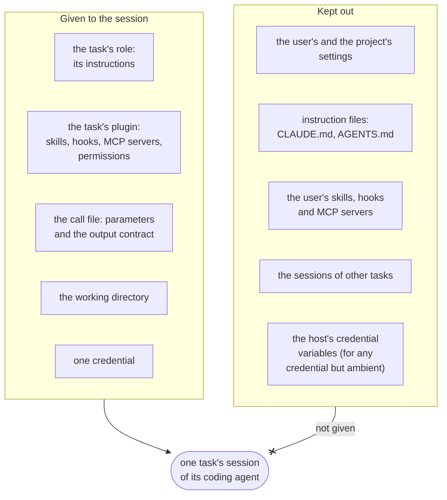
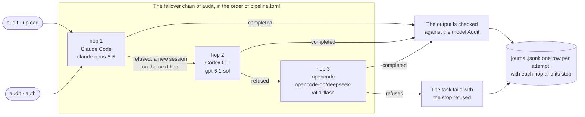
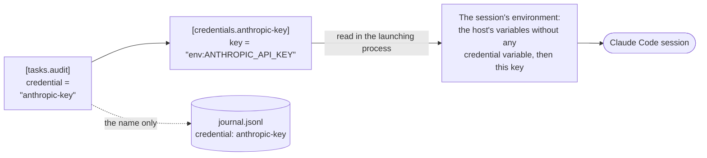

<h1>
  
</h1>

contraagent runs coding agents as typed, checked and supervised tasks. Claude Code,
Codex CLI, opencode, oh-my-pi and pi become the steps of a Python pipeline. Each
task is a typed function whose body is a coding agent, and its result is a file that
contraagent checks against a pydantic model. The runner schedules the tasks and
handles failover, quotas, deadlines and resume, and a live monitor shows every run.


## Start

You ask your coding agent to write the pipeline. It can, because the package ships
its documentation for coding agents: `contraagent docs` prints it, and it matches
the installed version.

Install contraagent in your project. Real runs need Linux, Python 3.12 or later, and
a coding agent on `PATH`.

```
uv add 'contraagent[monitor]'       # or: pip install 'contraagent[monitor]'
```

`contraagent docs --pointer` prints a short block for the instruction file that your
coding agent reads. The block tells the agent where the documentation is, what to
read first, and how to check its work. Add it to that file yourself, for example to
`AGENTS.md` (Claude Code reads `CLAUDE.md`). contraagent does not write into your
project.

```
contraagent docs --pointer >> AGENTS.md
```

Then ask for the pipeline in plain words. The request names no coding agent, so
Claude Code, Codex, opencode, omp and pi can each take it.

```text
Use contraagent to write a pipeline that reviews each module in src/ and writes a
JSON report per module with its findings. Check it with `contraagent check` and test
it with a stub run.
```

The agent runs `contraagent check` and the stub run itself. Neither launches a
coding agent, and neither spends anything. You then run the pipeline on the real
coding agents with `contraagent run --config pipeline.toml`, and watch it in
`contraagent monitor`.

To see the monitor first, `python -m contraagent.docs.examples.demo.run` runs the
demo pipeline on a demo agent, which launches no coding agent and spends nothing. It
serves the monitor on http://127.0.0.1:8787.

## Example

The code below is part of the tutorial's pipeline, which triages bug reports. A
pipeline that your coding agent writes has the same parts: pydantic models, agent
tasks and a flow.

<!-- ::code{file="src/contraagent/docs/examples/tutorial/tasks.py" from="from typing import" to="class Triage"} -->
<!-- ::code{file="src/contraagent/docs/examples/tutorial/tasks.py" from="class Triage" to="class FixPlan"} -->
<!-- ::code{file="src/contraagent/docs/examples/tutorial/tasks.py" from="triage = agent_task(" to="plan_fix = agent_task"} -->
<!-- ::code{file="src/contraagent/docs/examples/tutorial/tasks.py" from="def triage_one" to="def triage_and_plan"} -->
```python
from typing import Literal

from pydantic import BaseModel, Field

from contraagent import agent_task, python_task


class Triage(BaseModel):
    severity: Literal["low", "medium", "high"] = Field(description="high: users lose data or cannot work")
    area: str = Field(description="the part of the product the report is about, in one or two words")
    summary: str = Field(description="what goes wrong, in one sentence")


triage = agent_task(
    "triage",
    plugin="plugins/triage",
    role="triager",
    output=Triage,
    validators=[short_summary],
    max_turns=10,
    timeout_s=300,
)


def triage_one(name: str):
    """One report: its triage, and a fix plan when it is high severity."""
    found = yield triage(name, report=report_path(name))
    if found.severity == "high":
        yield plan_fix(name, report=report_path(name), triage=found)
    return found
```

<sub>This block is quoted from the tutorial's
[`examples/tutorial/tasks.py`](src/contraagent/docs/examples/tutorial/tasks.py), and
a test checks that the two are identical.</sub>

The flow around the tasks is plain Python. Each `yield` waits for a checked output,
so loops, branches and parallel tasks are ordinary code.

`contraagent check` reports every problem in the pipeline and launches nothing. With
`--stub`, `contraagent run` runs the whole flow on a stub agent, which plays scripted
replies and spends nothing. With `--config pipeline.toml`, it runs on the coding
agent and model that the config names. `contraagent monitor` then shows the runs in a
browser.

```
contraagent check tasks.py:triage_all --kwargs '{"reports": ["login-timeout", "csv-export"]}'
contraagent run tasks.py:triage_all --stub --kwargs '{"reports": ["login-timeout", "csv-export"]}'
contraagent run tasks.py:triage_all --config pipeline.toml --kwargs '{"reports": ["login-timeout", "csv-export"]}'
contraagent monitor --runs-dir runs      # http://127.0.0.1:8787
```

To write a pipeline yourself, or to understand what the agent wrote, follow the
[tutorial](src/contraagent/docs/tutorial.md). It builds this pipeline from an empty
directory.


<sub>The monitor after a run of the demo pipeline (`examples/demo/`) on its demo
agent. All 44 tasks are done, and the pipeline graph draws the flow as it is
written, by function and loop, with a mark for each unit.</sub>

## How a task runs

A task is one kind of work applied to one unit, such as `triage` for the report
`login-timeout`. `agent_task` declares the kind with its output model, its
validators, its plugin and role, and its limits. The implementation is not Python
code. It is a plugin in the coding agent's own format, with roles (subagents),
skills, MCP servers, hooks and permissions, and the agent keeps its built-in tools.
In the example, the instructions for a triage are the role `triager` in
`plugins/triage`.

contraagent launches the coding agent for the task in a clean context. The agent
sees its role, its plugin, its skills and its call file, which holds the task's
parameters and output contract. The user's and the project's settings, instruction
files (`CLAUDE.md`, `AGENTS.md`), skills, hooks and MCP servers are excluded, and so
are the conversations of other tasks.

The agent writes the output file, and contraagent checks it against the pydantic
model and the validators. When a check fails, the errors go to the same agent
session, and the agent corrects the file in a correction round, up to a set number
of rounds. A `CommandValidator` also runs in the agent's own stop hook, so the agent
fixes the file before its turn ends. The flow receives the file as a typed object
only after it passes.

The runner manages the launches around this. After a rate limit or a failed launch,
a task moves along its kind's `fallbacks` to another model, coding agent or
credential (the account that the agent's API calls are billed to). Caps on a
subscription's 5-hour and weekly usage pause a credential until its usage window
resets. Work that cannot finish before the run's deadline is deferred, with its
cause recorded. `contraagent run --resume` runs a task again only when its
parameters, its definition or the outputs it received have changed.

## Why contraagent

contraagent is for work that you give a coding agent many times, once for each item,
such as a review of every module or a triage of every report. It has no agent loop of
its own and no tool API of its own. It runs the coding agents that you already use,
and adds what a pipeline of them needs.

- The same task, plugin and config run on `claude -p`, `codex exec`, `opencode run`,
  `omp -p` and `pi -p`. `pipeline.toml` chooses the coding agent and model for each
  kind, and with `--agent` every task of a run uses another coding agent. You write
  hooks once in `hooks.toml`, and contraagent renders them into the hook system of
  each agent. The agents load a plugin in different ways, and the page
  [Coding agents](src/contraagent/docs/agents.md) has a row for each difference.
- With only the task's purpose in its context, the agent is less likely to follow
  unrelated text, and a model's safeguards are less likely to misread legitimate work
  such as security research. Some coding agents have
  [exceptions](#for-security-engineers) to the clean context.
- Failover works for each task on its own. Each route of a `fallbacks` chain names a
  model, a coding agent and a credential, and each launch on a route is a hop. A
  safeguard refusal moves only the refused task to its next hop. A preflight checks
  every route before the first launch.
- A function that the flow calls can have its own deadline (`time_box`), and a
  deferred task is not a failure. Tasks that share a resource can claim its name
  (`claims`) so that they run one at a time. Each kind also has its own limit of
  tasks that run at once.
- A task whose input is missing does not start, and its recorded cause names the
  earlier task. On resume, a task's `fingerprint`, a digest of its parameters, its
  definition and the outputs it received, decides whether it runs again.
- The documentation, the docstrings of the typed public API and the messages of
  `contraagent check` are written for the coding agent that writes the pipeline, so
  it needs no source code of contraagent. `contraagent check` reports every problem
  at once, each with the topic that explains it.
- The public modules ship `py.typed`, and a test compares the public API with a saved
  snapshot. Every file that a run writes has a JSON Schema, and so does the config
  file. The monitor's HTTP API has an OpenAPI document.
  [Compatibility](src/contraagent/docs/compatibility.md) states what is public.

## The monitor and the audit trail

Every agent session leaves a record in the run directory, and the read-only monitor
(`contraagent monitor`) shows it for all five coding agents, live and after the run.
For each task, it shows the transcript of each session with its tool calls, web
searches, messages and reasoning, the files the task changed, model switches,
failed checks and corrections, deferrals, tokens, cost and subscription usage. A
live process tree of the agent sessions and Python tasks comes from `/proc`. The
events are what each coding agent reports in its own output, plus that process tree.
They are not a kernel-level capture of every file or network access. The topic
[The monitor](src/contraagent/docs/monitor.md) describes every view, and the
documentation site's
[element gallery](web/apps/docs/src/content/docs/elements.mdx) shows each of them
live with the demo run.


<sub>The task detail of `write_note · alpha`. The first version of the note failed
two checks, the errors went to the same session, and the corrected version
passed.</sub>

`contraagent run --record DIR` keeps each attempt, and `--replay DIR` replays those
recordings in place of the coding agent, with nothing spent. In pytest,
`contraagent.testing.StubAgent` plays scripted replies. With several hosts,
`contraagent relay` on each host sends its runs to a
[hub](src/contraagent/docs/hub.md) (`contraagent hub`), which serves one monitor for
all of them.

## For security engineers

This section describes what a task's coding agent receives, what happens when a
model's safeguards refuse a task, how a credential reaches a launch, and what a run
records. The pages
[Coding agents](src/contraagent/docs/agents.md) and
[What a task agent sees](src/contraagent/docs/plugins.md#what-a-task-agent-sees)
give the details for each coding agent.

### A clean context for each task

Each task runs in a new session of its coding agent. The session receives what the
task defines, and the rest of the host's agent setup is kept out.



The agent keeps its own built-in tools. Claude Code runs with `--setting-sources ""`
and `--strict-mcp-config`, and its `CLAUDE.md` files and auto-memory are disabled.
Codex runs with `--ignore-rules`, its plugins are disabled, and it reads no
`AGENTS.md`.

Three exceptions remain. The page [Coding agents](src/contraagent/docs/agents.md)
and the table in
[What a task agent sees](src/contraagent/docs/plugins.md#what-a-task-agent-sees)
list them with the rest of each agent's differences.

- opencode reads the user's `~/.config/opencode`. A light launch (a task with no
  tools) does not.
- Codex reads the user's `config.toml` when it runs on `ambient`, the host's own
  login.
- On omp, contraagent verifies that a launch uses only its own credential for the
  providers `anthropic`, `openai-codex` and `litellm`. Other omp providers are not
  verified.

### A refused task moves to another coding agent

A model's safeguards can refuse legitimate work, such as a security review. A launch
that ends this way has a stop of its own, `refused`. The task then moves to the next
hop of its kind's failover chain. Each hop names a coding agent, a model and a
credential, so the next hop can be another coding agent on another provider.

The config below runs the kind `audit` on Claude Code with Claude Opus 5.5. Hop 2 is
Codex CLI with GPT-6.1 Sol. Hop 3 is opencode with DeepSeek V4.1 Flash, through an
OpenCode Go key.

<!-- ::code{file="src/contraagent/docs/examples/security/pipeline.toml" from="[tasks.audit]"} -->
```toml
[tasks.audit]
agent = "claude"
model = "claude-opus-5-5"
credential = "anthropic-key"
max_turns = 40
timeout_s = 1800

# Block order is hop order: this block is hop 2, the next one hop 3.
[[tasks.audit.fallbacks]]
agent = "codex"
model = "gpt-6.1-sol"
credential = "openai-key"

[[tasks.audit.fallbacks]]
agent = "opencode"
model = "opencode-go/deepseek-v4.1-flash"
credential = "opencode-go"

# Secrets are references (env:NAME or file:/path), read in the launching process.
# A launch on one of these starts without the host's other credential variables.

[credentials.anthropic-key]
type = "api_key"
provider = "anthropic"
key = "env:ANTHROPIC_API_KEY"

[credentials.openai-key]
type = "api_key"
provider = "openai"
key = "env:OPENAI_API_KEY"

[credentials.opencode-go]
type = "api_key"
provider = "opencode-go"
key = "file:/run/secrets/opencode-go-key"
```

<sub>This block is quoted from
[`examples/security/pipeline.toml`](src/contraagent/docs/examples/security/pipeline.toml).
A test runs `contraagent check` on it with its flow
([`flow.py`](src/contraagent/docs/examples/security/flow.py)), and a stub run in
which one task is refused on hop 1 and another on every hop.</sub>

Two tasks of that run go through the chain in different ways. The task
`audit · upload` is refused on hop 1, and the task `audit · auth` is not.



- contraagent reads the refusal from the coding agent's output. The journal keeps
  the provider's text in the attempt's reason.
- The task is not launched on the same route again. Its next session starts on the
  next hop, with the same call file.
- The hops follow the order of the `[[tasks.audit.fallbacks]]` blocks. A kind's own
  blocks replace `[[defaults.fallbacks]]`.
- Only the refused task moves. The next task of the kind still starts on hop 1. A
  rate limit (a 429) is different: it moves every task of the kind until the first
  hop answers again.
- When every hop refuses, the task fails with the stop `refused`. It is not retried,
  and a task that needs its output does not start.
- The journal row lists each hop with its coding agent, model, credential and stop.
  Its reason is, for example, `safeguard refusal on hop 1/3
  claude/claude-opus-5-5@anthropic-key (<the provider's text>); failing over to hop
  2/3 codex/gpt-6.1-sol@openai-key; ran on hop 2/3 codex/gpt-6.1-sol@openai-key`.
  The monitor shows it as a model switch.
- Before the first launch, contraagent checks every hop as it checks the first one.
  A kind with `disallowed_tools` cannot have a hop on Codex or omp, because neither
  can deny a tool.

### How a credential reaches a launch



- The config names the credentials. They can be subscriptions, API keys, OAuth
  tokens, gateways, Bedrock, Vertex or pools.
- A secret in the config is a reference, `env:NAME` or `file:PATH`. contraagent
  refuses an inline value. It reads the value in the launching process and writes
  it nowhere.
- A launch on any credential but `ambient` starts without the host's credential
  variables (`ANTHROPIC_API_KEY`, any `*_API_KEY`, `*_AUTH_TOKEN`, ...). It then
  gets the one credential that its hop names. A tool that needs a key of its own
  gets it through `Pipeline(env=...)`.
- `ambient` is the host's own login. A launch on it keeps the host's environment.
- The journal records a credential's name, never its value.
- A launch whose coding agent reports a credential source that does not match its
  credential ends with the stop `credential_mismatch`. It does not move to another
  hop.
- A gateway's `headers` are plain config values, not secrets.

### Limits, isolation and records

| What | Where it is enforced or recorded |
|---|---|
| Tools a kind may not use | `disallowed_tools` in the config. A route whose coding agent cannot deny the tools is refused before anything launches. |
| Limits of a launch | A time limit (`timeout_s`) and a turn limit (`max_turns`) for every kind, and a cost limit (`max_budget_usd`) and a stall limit (`stall_s`) when the config sets them. The page [Coding agents](src/contraagent/docs/agents.md) shows which limits each coding agent holds. |
| The processes of a launch | A process group of its own. contraagent ends the group when the pipeline ends or is interrupted. |
| Codex's sandbox | Its `workspace-write` sandbox, with the network on, and a temporary directory of its own for each launch. |
| Scratch directories | `<temp dir>/contraagent-<uid>/`, usable only by its owner. contraagent refuses a symbolic link or another user's directory there. |
| Each attempt | `journal.jsonl`: the coding agent, model, credential name, hops, tokens, cost, web searches, and the changed files among those the task declares with `changes=`. |
| Each launch | `launches.jsonl`: the command line, with the prompt cut to 200 characters, and the refused tool calls. |
| What each agent was given, and what it did | The run directory: the call file of each task (`calls/`) and the transcript of each task (`streams/`). |
| Who can read a run | The monitor answers GET requests only and binds to 127.0.0.1 by default. It answers only local host names and the names given with `--allow-host`. |
| A run shared as a file | `contraagent monitor export` never includes transcripts or processes. By default it redacts paths and host names. |
| Runs of several hosts | A hub requires an ingest token for each host, and a token bound to one host cannot send the runs of another host. The hub's monitor requires a read token. The hub reads its tokens from files and compares them in constant time. |

The journal and the transcripts hold what each coding agent reports in its own
output. The monitor adds a live process tree from `/proc`. Neither is a
kernel-level capture of every file or network access.

## When to use something else

For your own agent loop over a model API, with your own tools and prompts and typed
output in your process, use an agent SDK such as Pydantic AI, the OpenAI Agents SDK
or LangGraph.

To run Claude Code's agent inside an application, or to run one agent for each pull
request or issue, use the Claude Agent SDK or claude-code-action.

For workflows that are mostly not coding-agent work, use Temporal, Prefect or
Airflow. Examples are jobs that extract, transform and load data, scheduled batch
jobs, and business processes that run for a long time. Such a workflow can call a
contraagent pipeline as one step.

One agent call on one file needs only `claude -p`. Typed outputs, correction rounds,
failover and the monitor are useful over many tasks, or when runs must be
repeatable.

## Coding agents

| Agent (`agent`) | CLI | A launch runs |
|---|---|---|
| `claude` | Claude Code | `claude -p --output-format stream-json` |
| `codex` | Codex CLI | `codex exec --json` |
| `opencode` | opencode | `opencode run --format json` |
| `omp` | oh-my-pi | `omp -p`, or `omp --mode rpc` (`omp-rpc`) |
| `pi` | pi (pi.dev) | `pi --mode json -p` |

Their CLIs enforce different things, such as stop hooks, budgets, quota readings and
tool denial. The page [Coding agents](src/contraagent/docs/agents.md) lists each
difference. A coding agent of your own is a subclass of `Backend`.

## Documentation

This repository holds four packages, and each has its own documentation.

| Package | What it is | Documentation |
|---|---|---|
| `contraagent` (Python) | pipelines of coding-agent tasks, their runner, the monitor, the hub | [src/contraagent/docs/](src/contraagent/docs/README.md) |
| `@contraagent/ui` (npm) | the monitor and its views as web components | [web/packages/ui/](web/packages/ui/README.md) |
| `@contraagent/elements` (npm) | generic web components (`cae-*`), themes and design tokens, with no contraagent data | [web/packages/elements/](web/packages/elements/README.md) |
| `@contraagent/api` (npm) | the typed client for the monitor's API | [web/packages/api/](web/packages/api/README.md) |

`pnpm docs` in `web/` serves the documentation site, which renders all four. The npm
packages are not published to the npm registry. `pnpm tarballs` in `web/` packs them
so that you can install them from this checkout, and `pnpm --dir web screenshots`
makes the screenshots in this README.

[AGENTS.md](AGENTS.md) is for work on contraagent itself, and
[CHANGELOG.md](CHANGELOG.md) lists the changes. contraagent is MIT licensed.
