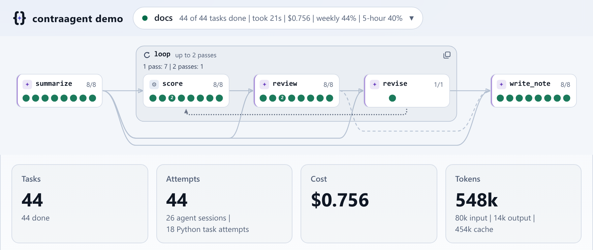
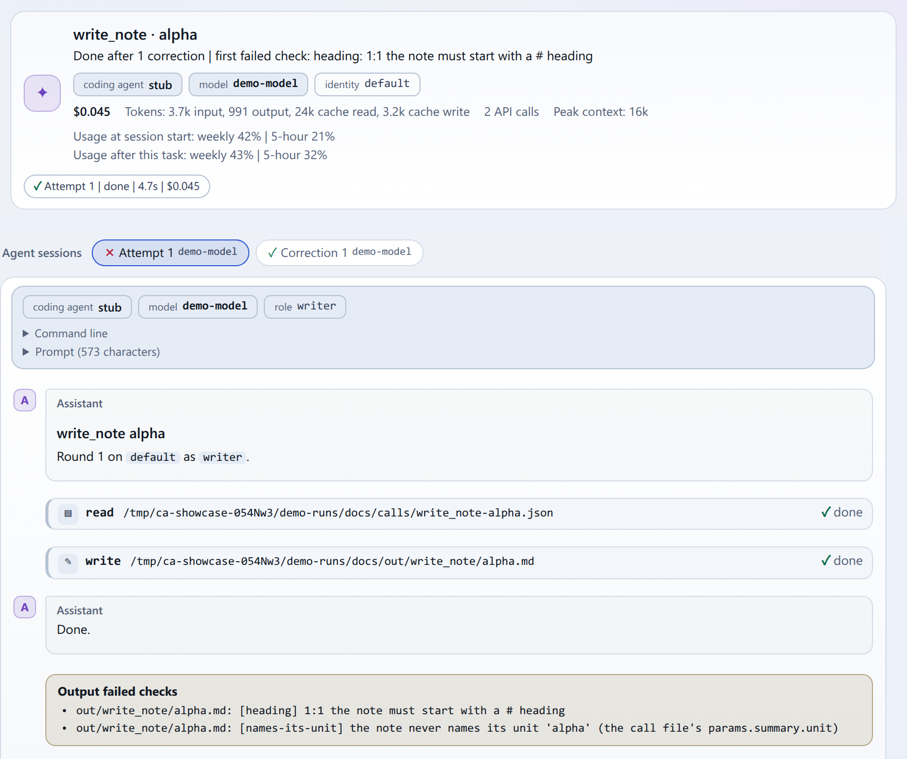
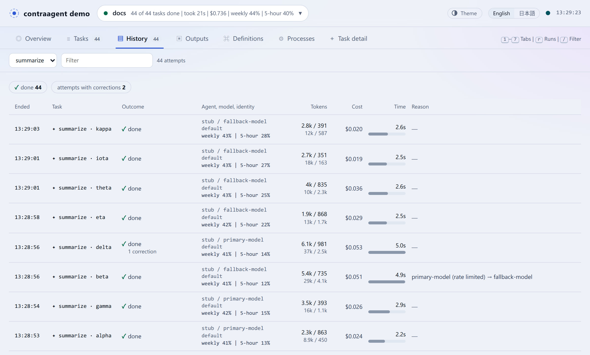
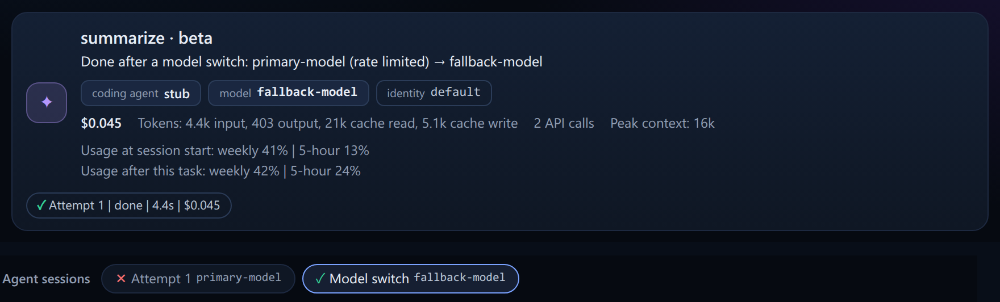
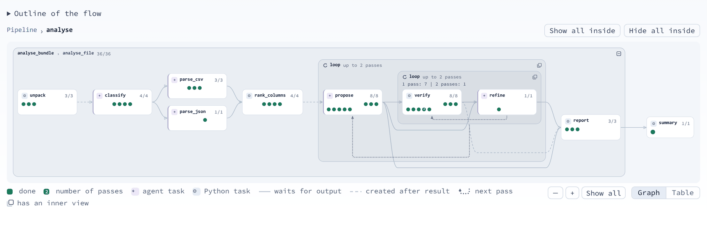
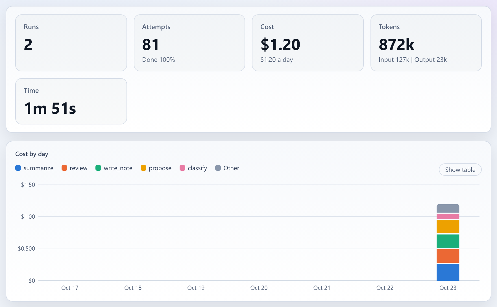

# contraagent

**Run coding agents as typed, checked, supervised tasks.** contraagent makes Claude
Code, Codex CLI, opencode, oh-my-pi and pi the steps of a Python pipeline. Each task
is a typed function whose body is a coding agent. The task's result is a file, and
contraagent checks it against a pydantic model. The runner handles scheduling,
failover, quotas, deadlines, resume and a live monitor.




<sub>The monitor shows the demo pipeline, run on its demo agent. Every task is done,
and every output passed its checks. 2 outputs were corrected in their own sessions,
1 model switch followed a rate limit, and a review loop ran a second pass for one
unit (one item that the pipeline works on).</sub>

## A task is a function whose body is a coding agent

<!-- ::code{file="src/contraagent/docs/examples/tutorial/tasks.py" from="from typing import" to="class Triage"} -->
<!-- ::code{file="src/contraagent/docs/examples/tutorial/tasks.py" from="class Triage" to="class FixPlan"} -->
<!-- ::code{file="src/contraagent/docs/examples/tutorial/tasks.py" from="triage = agent_task(" to="plan_fix = agent_task"} -->
<!-- ::code{file="src/contraagent/docs/examples/tutorial/tasks.py" from="def triage_one" to="def triage_and_plan"} -->
```python
from typing import Literal

from pydantic import BaseModel, Field

from contraagent import agent_task, python_task


class Triage(BaseModel):
    severity: Literal["low", "medium", "high"] = Field(description="high: users lose data or cannot work")
    area: str = Field(description="the part of the product the report is about, in one or two words")
    summary: str = Field(description="what goes wrong, in one sentence")


triage = agent_task(
    "triage",
    plugin="plugins/triage",
    role="triager",
    output=Triage,
    validators=[short_summary],
    max_turns=10,
    timeout_s=300,
)


def triage_one(name: str):
    """One report: its triage, and a fix plan when it is high severity."""
    found = yield triage(name, report=report_path(name))
    if found.severity == "high":
        yield plan_fix(name, report=report_path(name), triage=found)
    return found
```

<sub>From the tutorial's pipeline,
[`examples/tutorial/tasks.py`](src/contraagent/docs/examples/tutorial/tasks.py). A
test checks that this block is identical to that file.</sub>

The steps of a triage are in the plugin `plugins/triage`, as a role that the coding
agent loads itself. The flow is plain Python. A `yield` waits for the checked output,
so loops, branches and parallel tasks are ordinary code. The four commands below run
in this order. The first reports every problem and launches nothing. The second runs
the whole flow on a stub agent, which plays scripted replies and spends nothing. The
third runs the flow on the coding agent and model that `pipeline.toml` names. The
fourth starts the monitor.

```
contraagent check tasks.py:triage_all --kwargs '{"reports": ["login-timeout", "csv-export"]}'
contraagent run tasks.py:triage_all --stub --kwargs '{"reports": ["login-timeout", "csv-export"]}'
contraagent run tasks.py:triage_all --config pipeline.toml --kwargs '{"reports": ["login-timeout", "csv-export"]}'
contraagent monitor --runs-dir runs      # http://127.0.0.1:8787
```

The [tutorial](src/contraagent/docs/tutorial.md) builds this pipeline from an empty
directory.

## Why contraagent

contraagent is for work that you give a coding agent many times, once for each item:
review every module, triage every report, migrate every service. It has no agent loop
of its own. It runs the coding agents that you already use, and adds what a pipeline
of them needs.

- **The coding agents themselves.** Each task runs `claude -p`, `codex exec`,
  `opencode run`, `omp -p` or `pi -p`. The same task, plugin and config run on each
  of them. `pipeline.toml` chooses the coding agent and model for each kind (the
  class of work that a task does, such as `triage`). With `--agent`, every task of a
  run uses another coding agent.
- **The agent's own extensions.** A task's implementation is a plugin in the coding
  agent's own format. A plugin holds roles (subagents), skills, MCP servers, hooks
  and permissions. The agent also keeps its built-in tools: shell, editing, and web
  search where the agent has it. contraagent has no tool API of its own. Hooks are
  written once in `hooks.toml`, and contraagent renders them into the hook system of
  each agent. Agents load a plugin in different ways. Claude Code and omp load it
  natively. opencode and pi load it through the flags and config that contraagent
  gives them. Codex runs with its own plugins disabled, and contraagent gives it the
  skills, hooks and MCP servers of the plugin.
  [Coding agents](src/contraagent/docs/agents.md) has a row for each difference.
- **A clean context per task.** A task's agent sees its role, its plugin, its skills
  and its call file (the parameters and output contract of the task). Each launch
  excludes the user's and the project's settings, instruction files (`CLAUDE.md`,
  `AGENTS.md`), skills, hooks and MCP servers. It also excludes the conversations of
  all other tasks. Each coding agent has some exceptions, and the
  [security section](#for-security-engineers) lists them. A narrow context holds
  only the purpose of the task. Unrelated text then has fewer chances to change what
  the agent does, or to make a model's safeguards misread legitimate work, such as
  security research.
- **Outputs are contracts.** Each output file is checked against its pydantic model
  and its validators. When an output fails, contraagent sends the errors to the same
  agent session, for a set number of correction rounds. A `CommandValidator` also
  runs in the agent's own stop hook, so the agent fixes the file before its turn
  ends. A task whose input is missing does not start, and the cause names the earlier
  task.
- **Failover and quotas.** A kind's `fallbacks` are a chain of routes. Each route is
  a model, a coding agent and a credential (the account that the agent's API calls
  are billed to). After a rate limit or a failed launch, the task launches again on
  the next route of its chain. Each launch on one route is a hop. After a safeguard
  refusal, only that task moves to its next hop. A cap on a subscription's 5-hour or
  weekly usage pauses a credential until its usage window resets. Before the first
  launch, a preflight checks every route.
- **Deadlines and scheduling.** A run can have a deadline. A function that the flow
  calls can also have its own deadline (`time_box`). contraagent defers the work that
  cannot finish before its deadline, and records the cause. A deferred task is not a
  failure. Tasks that share a resource can each claim its name (`claims`), and then
  they run one at a time. Each kind also has its own limit of tasks that run at once.
- **Resume.** `contraagent run --resume` compares the `fingerprint` of each task, a
  digest of its parameters, its definition and the outputs it received. It runs a
  task again only when its fingerprint changed.
- **Pipelines that a coding agent can write.** The package installs its documentation
  (`contraagent docs`, `contraagent docs <topic>`). `contraagent docs --pointer`
  prints a block that points the coding agent of a project to this documentation. The
  public API is typed and documented in its docstrings. `contraagent check` reports
  every problem at once, each with the topic that explains it.
- **A typed, stable surface.** The public modules ship `py.typed`, and a test
  compares the public API with a saved snapshot. Every file that a run writes has a
  JSON Schema, and so does the config file. The monitor's HTTP API has an OpenAPI
  document. [Compatibility](src/contraagent/docs/compatibility.md) states what is
  public.

## An audit trail and live telemetry

Every agent session leaves a record in the run directory. The monitor
(`contraagent monitor`, read-only) shows these records for all five coding agents,
live and after the run:

- **Processes**: a live process tree of the agent sessions and Python tasks, read
  from `/proc`.
- **Per-session events**, in time order: each tool call with its arguments and
  result, web searches with their results, pages fetched, the agent's messages and
  reasoning, API requests sent again.
- **Per-task facts**: the files changed under the task's declared patterns (created,
  modified, deleted), model switches and their causes, failed checks and the
  correction rounds that followed, deferrals with their causes, tokens, cost and the
  subscription usage at the start of each session.

The events are what each coding agent reports in its own output, plus the process
tree that contraagent reads. They are not a kernel-level capture of every file or
network access. When a task fails, you can reproduce the run.
`contraagent run --record DIR` keeps each attempt. `--replay DIR` replays the
recordings in place of the coding agent, and spends nothing. A stub run (a run that
launches no coding agent, `--stub`) or `contraagent.testing.StubAgent` in pytest
plays scripted replies.

**Checked, and corrected in the same session.** The task detail holds the transcript
of each agent session, with the task's input, output and definition. Here, the first
version of the note failed two checks. contraagent sent the errors to the same
session, and the corrected version passed. The task is done.



**Every attempt in the history.** The history has one row per attempt. Each row has
its outcome, coding agent, model, identity (the credential used), tokens, cost and
time. Here, every summary is done. One is done after a correction. Another is done
after a model switch from a rate-limited model to its fallback model. The later
summary tasks used the fallback model from their first attempt.



**A model switch, session by session**, in the dark theme. Each agent session has its
own transcript, tokens and cost.



**The flow as it is written.** The pipeline graph draws the flow by function and
loop, a mark per unit, the passes of each loop, and tasks that have not started.



**Trends** show totals over the runs of a period: cost by day and kind, tasks and
models.



**Many hosts.** `contraagent relay` on each host sends its runs to a
`contraagent hub`. The hub serves one monitor for the runs of all hosts
([the hub](src/contraagent/docs/hub.md)).

## For security engineers

This section states what a task's coding agent can see and do, and what a run
records, as the code implements it. [Coding agents](src/contraagent/docs/agents.md)
and [Plugins](src/contraagent/docs/plugins.md#what-a-task-agent-sees) have the
details.

- **Context.** Each launch excludes the project's and the user's settings,
  instruction files, skills, hooks and MCP servers. It also excludes the sessions of
  all other tasks. Claude Code runs with `--setting-sources ""` and
  `--strict-mcp-config`, and with its `CLAUDE.md` files and auto-memory disabled.
  Codex runs with `--ignore-rules`, with its plugins disabled, and with no
  `AGENTS.md`. There are three exceptions. First, opencode still reads the user's
  `~/.config/opencode`, except on a light launch (a launch of a task with no tools).
  Second, Codex reads the user's `config.toml` when it runs on the host's own login
  (`ambient`). Third, on omp, a launch is verified to use only the credential that
  contraagent gives it for the providers `anthropic`, `openai-codex` and `litellm`.
  For other omp providers, this is not verified.
- **Safeguard refusals.** A safety refusal is a stop of its own (`refused`). The
  journal records it on its hop, with the text of the provider as the reason. The
  task is not retried on the same route. It moves to its next hop, and the other
  tasks stay on their first route.
- **Credentials.** The config names the credentials (subscriptions, API keys, OAuth
  tokens, gateways, Bedrock, Vertex, pools). A secret in the config is a reference
  (`env:NAME` or `file:PATH`), and contraagent refuses an inline value. The journal
  records the name of the credential, never its value. A launch on any credential
  except `ambient` (the host's own login) starts without the host's credential
  variables (`ANTHROPIC_API_KEY`, any `*_API_KEY`, `*_AUTH_TOKEN`, ...). The
  `headers` of a gateway are plain config values.
- **Tools and limits.** `disallowed_tools` denies tools for each kind. If the coding
  agent of a route cannot enforce the rule, contraagent refuses the route before
  anything launches. Each launch has its time, turn and budget limits, and stall
  detection. Each launch runs in a process group of its own. contraagent ends that
  process group when the pipeline ends or is interrupted.
- **Sandbox and scratch.** Codex runs in its `workspace-write` sandbox (network on),
  with a temporary directory of its own for each launch. Scratch directories are
  under `<temp dir>/contraagent-<uid>/`, and only their owner can use them.
  contraagent refuses a symbolic link or the directory of another user there.
- **Audit trail.** Each run writes these records. `journal.jsonl` has one row per
  attempt: coding agent, model, credential name, hops, tokens, cost, web searches,
  and the files that the task changed among those it declared with `changes=`.
  `launches.jsonl` has the command line of each launch, with its prompt truncated to
  200 characters, and its refused tool calls. The run also keeps the call file that
  each agent was given, and the transcript of each task.
- **Monitor and hub.** The monitor is read-only (GET only). By default, it binds to
  127.0.0.1. It answers only local host names and the host names given with
  `--allow-host`. `contraagent monitor export` excludes transcripts and processes.
  By default, it also redacts paths and host names. A hub requires an ingest token
  for each host, and a token bound to one host cannot send the runs of another host.
  The monitor of a hub requires a read token. The hub reads the tokens from files and
  compares them in constant time.

## When to use something else

- **Your own agent loop over a model API** (your tools, your prompts, typed output in
  your process): an agent SDK such as Pydantic AI, the OpenAI Agents SDK or
  LangGraph.
- **Claude Code's agent inside an application**, or one agent run per pull request or
  issue: the Claude Agent SDK, or claude-code-action.
- **Workflows that are mostly not coding-agent work** (jobs that extract, transform
  and load data, scheduled batch jobs, business processes that run for a long time):
  Temporal, Prefect or Airflow. These can call a contraagent pipeline as one step.
- **One agent call on one file:** `claude -p` alone is enough. Typed outputs,
  correction rounds, failover and the monitor are useful over many tasks, or when
  runs must be repeatable.

## Coding agents

| Agent (`agent`) | CLI | A launch runs |
|---|---|---|
| `claude` | Claude Code | `claude -p --output-format stream-json` |
| `codex` | Codex CLI | `codex exec --json` |
| `opencode` | opencode | `opencode run --format json` |
| `omp` | oh-my-pi | `omp -p`, or `omp --mode rpc` (`omp-rpc`) |
| `pi` | pi (pi.dev) | `pi --mode json -p` |

The CLIs of these coding agents enforce different things (stop hooks, budgets, quota
readings, tool denial). [Coding agents](src/contraagent/docs/agents.md) lists the
differences. To add a coding agent of your own, write a subclass of `Backend`.

## Install

Linux, Python 3.12 or later, and a coding agent on `PATH` for real runs:

```
uv add 'contraagent[monitor]'       # or: pip install 'contraagent[monitor]'
```

`python -m contraagent.docs.examples.demo.run` runs the demo pipeline on a demo agent
and serves the monitor on http://127.0.0.1:8787. The demo agent launches no coding
agent and spends nothing.

## Documentation

This repository holds four packages, each with its documentation:

| Package | What it is | Documentation |
|---|---|---|
| `contraagent` (Python) | pipelines of coding-agent tasks, their runner, the monitor, the hub | [src/contraagent/docs/](src/contraagent/docs/README.md) |
| `@contraagent/ui` (npm) | the monitor and its views as web components | [web/packages/ui/](web/packages/ui/README.md) |
| `@contraagent/elements` (npm) | generic web components (`cae-*`), themes and design tokens, with no contraagent data | [web/packages/elements/](web/packages/elements/README.md) |
| `@contraagent/api` (npm) | the typed client for the monitor's API | [web/packages/api/](web/packages/api/README.md) |

`pnpm docs` in `web/` serves the documentation site, which renders all four. The npm
packages are not published to the npm registry. `pnpm tarballs` in `web/` packs them,
so that you can install them from this checkout. `pnpm --dir web screenshots` makes
the screenshots above.

Working on contraagent itself: [AGENTS.md](AGENTS.md). Changes:
[CHANGELOG.md](CHANGELOG.md). MIT licensed.
