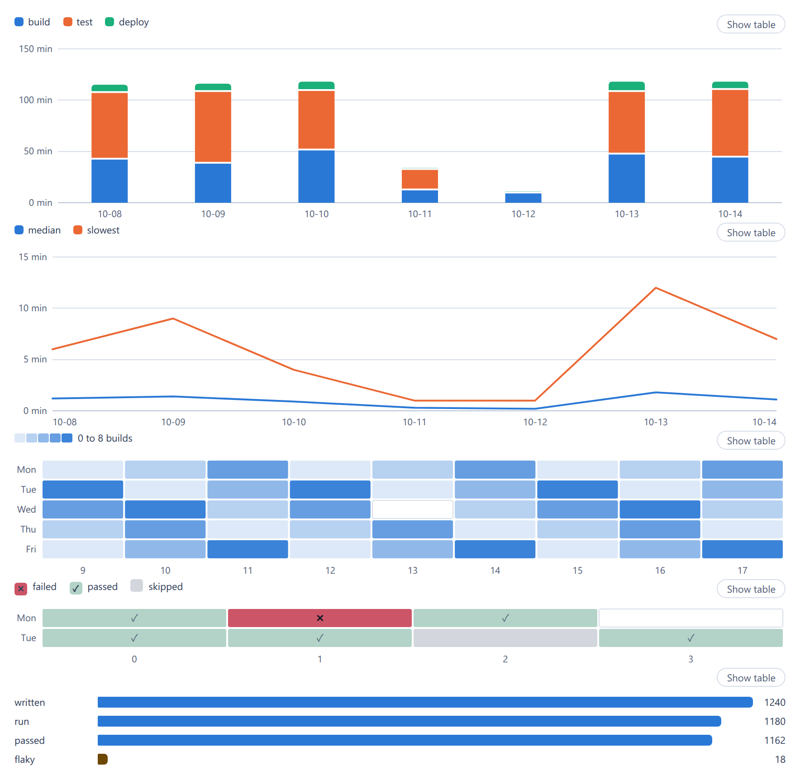

# Charts

Five charts of plain series: `<cae-column-chart>` (vertical bars, stacked or
side by side), `<cae-line-chart>`, `<cae-heatmap>`, `<cae-state-grid>` (a state
per row and column) and `<cae-bar-chart>` (horizontal bars). Register them with
`@contraagent/elements/charts/define`; the types and the arithmetic they share
are in `@contraagent/elements/charts`.

::code{file="examples/charts.ts"}

## Series and values

A chart takes labels (`x`) and series, each a name and a value per label; a
null value is a value the series has not: no bar, a break in a line, an empty
cell. A heatmap takes its rows (`y`), its columns (`x`) and `values[row][column]`;
a state grid the same rows and columns and `cells[row][column]`, each a state's
`label`, its `tone` and an optional `tip` (null: no cell); a bar chart takes
`bars`, each a label, a value and an optional `tone`.

::code{file="../src/charts/types.ts" from="/** One series" to="/** The words of a chart"}

`format` writes a value in words (`$1.20`, `42%`, `2m 05s`): on the axis, in the
tooltip and in the table. It is the host's, since the chart does not know the
unit.

## Colour

The series take the series colours (`--ca-series-1` to `--ca-series-6`) in
their order, so a series keeps its colour whatever its values and its rank. A
chart never makes up a seventh colour: past six series, a column chart sums the
sixth and later into one series, `strings.other`, in the neutral `--ca-meter`;
a line chart draws them in that colour and names each in the legend and the
tooltip. A heatmap uses one hue, light to dark in five steps between its lowest
and highest value. A state grid colours a cell by its tone, so a failure and
what needs attention stand out and a cell that ended well stays quiet; the
colour is never alone: a cell wide enough holds its tone's mark (✓ done,
✕ failed, ◌ attention; a done cell's mark is quieter), the legend names each
state once, failures and what needs attention first, and the tooltip and the
table say the state in words. A bar
with a `tone` takes that status colour; a status colour is never a series.

## Reading it

Two or more series have a legend; one series has none, since the chart's title
names it. Pointing at a label, or moving to it with the arrow keys once the
chart has the focus (up and down by a row in a heatmap and a state grid, Home and End to the
ends, Escape to close), shows its values in a tooltip. Every chart has a switch
to a table of the same values (`strings.showTable`, `strings.showChart`), which
is also how a screen reader reads it. A bar chart writes each value beside its
bar.

## Look

`height` sets a column or line chart's height in px (200 by default; the rows of
a heatmap and of a state grid are 22px each). The parts are `plot`, `table`, `switch`, `legend` and
`empty`.
