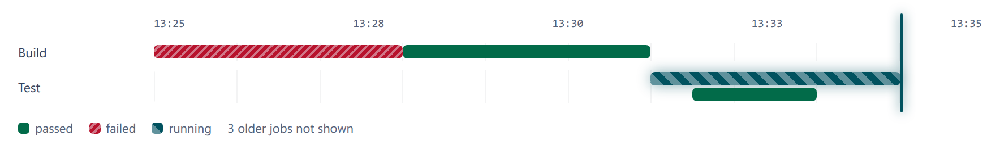

# Lanes

`<cae-lanes>` shows bars on a time axis, a lane per group: each bar as long as
the thing it stands for took. Register it with
`@contraagent/elements/lanes/define`; the types and the placement functions are
in `@contraagent/elements/lanes`.

Live, with its source: the documentation site's Live elements page (`pnpm docs` in `web/`), under `<cae-lanes>`.

::code{file="examples/lanes.ts"}

## Lanes and bars

A lane is a `Lane`, a bar a `LaneBar`: a start and an end in epoch
milliseconds, the key of its look and its tooltip. A bar with no end is
running: it grows until now, and a line marks now. Set `live` while a bar runs,
so the element draws again every second.

::code{file="../src/lanes/types.ts" from="/** Something that took time" to="/** A row of bars"}

The overlapping bars of a lane are stacked, each on the first row whose last
bar has ended (`stack`), so no bar hides another. The bars grow in when they
are first drawn.

## Looks and the legend

`barStyles` maps each key to a `LaneStyle`: a label, a colour, and a pattern
(`solid`, `hatched`, `striped`, which moves on a bar, or `outline`). Give a
status a pattern besides its colour, so it does not depend on colour alone. The
labels are the legend, a row per `group`, in key order; `omitted` adds a note
of the bars the host left out (`strings.omitted`).

## The axis

By default the axis fits the bars (`fitRange`): from the first start to the
last end; with a running bar, to now plus 20 seconds, rounded up to the minute.
Set `range` to fix it. The axis shows five times, with seconds when it spans
less than 10 minutes, in `locale` (by default the page's `lang`).

## Look

`--cae-lanes-label-width` sets the width of the lanes' labels (112px, 78px on
a narrow screen). The parts are `axis`, `lane`, `lane-label`, `track`, `bar`,
`now`, `legend` and `empty`; with no bars the element shows `strings.empty`, or
the `empty` slot.
