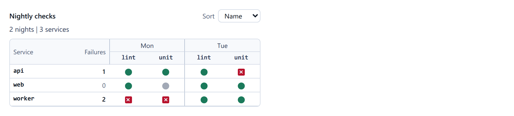

# Mark matrix

`<cae-mark-matrix>` shows marks in a table: a row per series (its label, then a
value), a column per item, the columns under nested groups. Register it with
`@contraagent/elements/matrix/define`; the types are in
`@contraagent/elements/matrix`.

<!-- not on the site -->
Live on this topic's page of the documentation site (`pnpm run docs` in `web/`).

::code{file="examples/matrix.ts"}

## The model

A `MarkMatrixInput` holds the header rows (outermost first), the columns, the rows
and the line above the table. A column names the groups it is under: a border marks
where a group starts. A mark is drawn in its state's look (`states`, as in the
[layered graph](graph.md)).

::code{file="../src/matrix/types.ts" from="export interface MatrixRowInput {" to="export interface MarkMatrixStrings {"}

## Keyboard and events

The marks are one tab stop. The arrow keys, Home, End, Page Up and Page Down move
between them (Ctrl with Home and End: the first and the last row). A click or the
focus sends `cae-select`; Enter or a double click sends `cae-activate`, or
`cae-drill` for a mark with `drill`. The sort control sends `cae-sort`: the host
sorts the rows and sets `sort`. Above `windowAt` rows (150), only the rows in view
are drawn.

The words are `strings` ([Strings](strings.md)): the sort control's label and the
header of the rows' labels.
