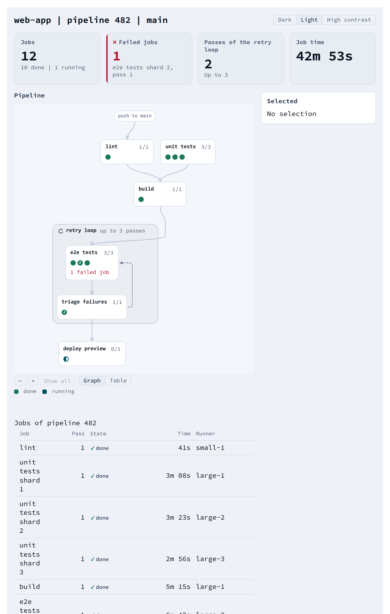

# Building a page

A page made of several elements: one run of a made-up CI pipeline, with a theme
switch, stat tiles, a sortable table of jobs, and a layered graph of the steps
beside a detail panel of the page's own. The whole example is
`docs/examples/ci-pipeline.ts`; it uses only the package's public entry points,
and `mount(host)` builds the page in any element.

<!-- not on the site -->
Live on this topic's page of the documentation site (`pnpm run docs` in `web/`).

## What the page holds

The elements keep no state of their own that the page needs: each one draws
what its properties give it and sends a `cae-*` event for what the reader did.
The page holds the data, the theme, the selection and the order of the table,
and sets them back on the elements.

| The reader | The element sends | The page sets |
|---|---|---|
| picks a theme | `cae-change` from `<cae-segmented>` | `data-ca-theme` on the page's box, and the control's `value` |
| sorts a column | `cae-sort` from `<cae-data-table>` | the table's `sort`, and its `rows` in that order (`sortRows`) |
| opens a row | `cae-activate` from `<cae-data-table>` | the graph's `selected`, and the panel |
| selects a mark, a node or the loop | `cae-select` from `<cae-layered-graph>` | the graph's `selected`, and the panel |

## Registering and theming

Each `define` entry registers its elements; `adoptThemes(document)` adds the
themes' rules once, and `data-ca-theme` on any ancestor then picks a theme
([Theming](theming.md)).

::code{file="examples/ci-pipeline.ts" from="import '@contraagent/elements/segmented/define'" to="// ---- The data"}

## Widths

Each element is as wide as its container and lays itself out by its own width,
not the window's: its host is a CSS container (`container-type: inline-size`),
so the same element fits a sidebar, a column or a whole page. Its width does
not come from its content: in a flex row, give it a width or `flex: 1`. A table
wider than its element scrolls inside its own box. This page's two columns
become one below 760 px of the page's own width (`@container` in its stylesheet).

## The data

A step is a node of the graph and a job is one run of it, or of one of its
shards. The steps `e2e` and `triage` repeat in a retry loop.

::code{file="examples/ci-pipeline.ts" from="// ---- The data" to="// ---- What each state"}

## States

A state is the page's own word: `StateStyles` gives each one a tone, a shape
and a rank, and the legend follows its key order.

::code{file="examples/ci-pipeline.ts" from="// ---- What each state" to="// ---- The graph"}

## The graph

The shards are the graph's `series`, so shard 2 is at the same place in every
node that has shards; a step that runs once has one mark in `loose`. Each mark
shows the last pass of its job, and the number of passes as its `badge`. The
loop is a cluster that `cycle`s, closed by an edge with `ranks: false`. A
node's `counts` and `progress` follow from its marks. The page puts nothing in
the graph's `inspector` slot, so the graph draws no card beside the selection:
the panel beside the graph describes it.

::code{file="examples/ci-pipeline.ts" from="// ---- The graph" to="// ---- The table"}

## The table and the tiles

A column with `compare` sorts by it; a column with `sortable` and no `compare`
sorts by its cell, a string or a number.

::code{file="examples/ci-pipeline.ts" from="// ---- The table" to="// ---- The page's own styles"}

## The page's styles

The page's own text and boxes take the theme's colours (`--ca-*`), so they
change with the switch.

::code{file="examples/ci-pipeline.ts" from="// ---- The page's own styles" to="// ---- The page: build it"}

## The page

::code{file="examples/ci-pipeline.ts" from="// ---- The page: build it"}
