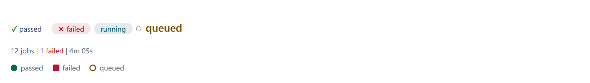

# Primitives

The parts every element is built from, in `@contraagent/elements/primitives`.
Most are template functions that a Lit element calls in its `render()`; their
look comes from the element's styles, which start from `base`
(`@contraagent/elements/styles`: the tokens, the status rules, chips, layout
and motion).

## Tones

A tone is the status colour a value takes: `failed`, `attention`, `done`,
`running`, `muted`, or `neutral` (the text colour). The names are the token
names (`--ca-status-<tone>`, [Theming](theming.md)). An element shows a tone as
`data-tone`, and `neutral` as no attribute (`toneAttr`).

::code{file="../src/core/tone.ts" from="/** A status colour" to="export const TONES"}

## Statuses, legends and facts

`pill` draws a status as a pill, `statusWord` as a word in a row, and
`statusChip` in a class the element styles. Each sets `data-tone` and, where a
mark belongs, `data-mark` (✓ done, ✕ failed, ◌ pending): the mark is drawn by
CSS and hidden from screen readers, which read the word. A pill also has the
parts `pill` and `tone-<tone>`.

`legend` draws a list of entries, each a swatch (a colour, a tone and a shape,
a class, or an icon of its own) and its word; add `legendStyles` to the
element's styles. `factLine` draws a row of facts separated by ` | ` that
breaks between facts, never inside one; a fact with a tone is in its status
colour.

::code{file="examples/status.ts"}

## Icons

`icon(name, label)` draws a glyph, or a template registered under `name` with
`registerIcon`. Without a label it is hidden from screen readers; with one, the
label is its tooltip and what a screen reader reads.

## The segmented control

`<cae-segmented>` is one choice among a few: a radio group, one tab stop, the
arrow keys, Home and End to choose. It sends `cae-change` with the chosen
value; the host keeps `value`.

::code{file="examples/segmented.ts"}

## Keyboard and long lists

`RovingFocusController` gives a group of items one tab stop and moves the
focus with the arrow keys, in a row, a column or a grid (`rovingStep` is the
rule). `windowRows` is the arithmetic for drawing only the rows of a long list
that are on screen.

::code{file="../src/primitives/window.ts" from="/**" to="export function windowRows"}
