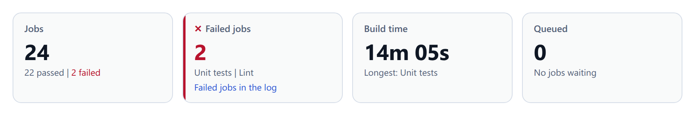

# Stat tiles

`<cae-stat-tiles>` shows figures as a grid of tiles: each a label, a value and
lines of facts under it. A tile with an action is a link as a whole. Register it with
`@contraagent/elements/tiles/define`, which also registers the `<cae-count>` a
tile's number counts up in; the types are in `@contraagent/elements/tiles`.

<!-- not on the site -->
Live on this topic's page of the documentation site (`pnpm run docs` in `web/`).

::code{file="examples/tiles.ts"}

## Tiles

A tile is a `StatTile`. Its value is a number or a text: a number counts up to a
new value, and the tile bumps when it changes (unless `bump` is off or the
reader asks for reduced motion). Each line under the value is a row of facts
(`factLine`, [Primitives](primitives.md)); a fact with a tone is in its status
colour, and an empty line keeps its place.

::code{file="../src/tiles/types.ts" from="/** A figure as a tile"}

A tile is neutral by default. A tile with a tone takes it on its value, on the
mark before its label (✓ done, ✕ failed, ◌ attention) and on a thin edge, and
has `data-tone`. Give a tone only to a figure that is a status, such as a count
of failures above 0; a total or a measure stays neutral.

## Events

A tile with an `action` is a link over the whole tile. The action's `label` is
the link's accessible name, and the tile shows no link text of its own. A click
sends `cae-action` with the tile's `id` and the action's `id`; the host decides
what it opens.

## Look

`columns` sets the tiles per row in a wide element (5); a narrower one has 4
below 1100px of its width, 2 below 660px and 1 below 240px. `--cae-stat-tiles-gap` sets the space between
the tiles. The parts are `tiles`, `tile` (with `data-id` and `data-tone`),
`label`, `value`, `sub` and `action` (the link over a tile).
