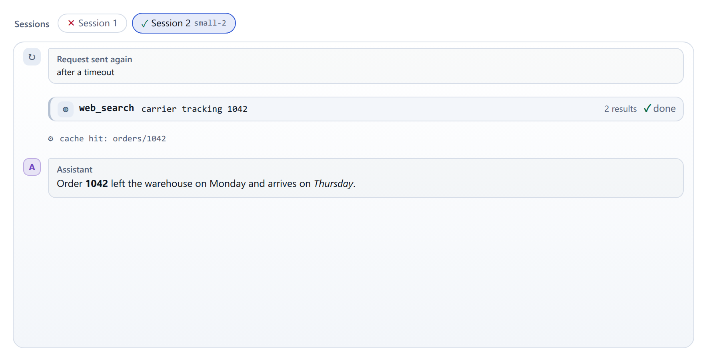

# Transcript

`<cae-transcript>` shows a conversation with an agent: chat bubbles for the
prompts, the answers and the model's reasoning, lines of the agent's own log,
and a card per tool call that opens on its command and output. A web search
lists the pages it returned as links; a page read shows its URL. Register it
with `@contraagent/elements/transcript/define`; the types are in
`@contraagent/elements/transcript`.

<!-- not on the site -->
Live on this topic's page of the documentation site (`pnpm run docs` in `web/`).

::code{file="examples/transcript.ts"}

## Sections and items

The conversation comes in sections, one per session with the agent. Above two
sections, a picker shows one at a time; each section names itself (`title`),
can add short facts after its name (a model) and a mark of how it ended
(`verdict`: ✓ with the tone `done`, ✕ otherwise). A section's head shows its
`tags` (who ran it) and its `details`: folded texts, code (a command line) or
prose (a prompt). A `footer` after the items says how the section ended, with
a list (errors) or a note.

::code{file="../src/transcript/types.ts" from="export interface TranscriptSection {" to="/** Where the reader was in a transcript. */"}

An item is a prompt, a message or reasoning (markdown), an event (a glyph, a
title and a detail), a notice, or a tool card. A prompt and reasoning show a
head over their bubble; the agent's messages show none, and their avatar
carries the name (`strings.assistant`) as its accessible name and tooltip:

::code{file="../src/transcript/types.ts" from="/** One tool call:" to="/** A labelled value in a section's head (who ran it). */"}

## Following and reading

`shown` picks a section (0-based); null follows the latest. While the reader
is at the bottom, new content scrolls into view. Once they scroll up, it stays
where they are, and a button counts what arrived below: `count` is how much
the transcript holds (by default its sections and items), so a host that
counts events sets it. A section that starts while the reader is scrolled up
in the latest one keeps the one they read on screen. `live` shows the agent
working, and a tool call with no result as running; without it, such a call
was interrupted.

A host that loads a transcript in pages sets `loading` until the first page
has arrived, and `earlier` to the number of lines before it that are not
loaded: a button then asks for them with `cae-load-earlier`, and the next
`sections` it gets is the content from further back, which keeps the reader's
place. For another transcript, give it a new element.

`memory` keeps what the reader opened and where they were: `isOpen` and
`setOpen` for the tool cards, `scroll` and `setScroll` for the position, which
is restored once the content has arrived. Without it, both last as long as the
element. `reveal(id)` opens a tool card and scrolls it into view once its
section is shown; it returns that section's index for the host to show.

## Events

- `cae-section-change` with `{index}`: the reader picked a section (null: the
  latest). The host sets `shown`.
- `cae-section-shown` with `{index}`: the section on screen changed (-1: none),
  also when a new section keeps the one being read.
- `cae-load-earlier`: the reader asked for the content before `earlier`.

## Look and words

Markdown is turned into HTML by `markdown` (`md` of
`@contraagent/elements/markdown` escapes the text); without it, answers and
reasoning show as plain text. `renderDetail` draws an open prose detail. The
parts are `picker`, `section`, `tag`, `bubble`, `notice`, `tool`, `tool-body`
and `verdict`; `tagChips` and `tagStyles` draw tags elsewhere in the same
look. The words are `strings` ([Strings](strings.md)): the picker's accessible
name (not shown) and tooltip, the bubbles' heads and the messages' name, the tool cards' statuses, the counts.
