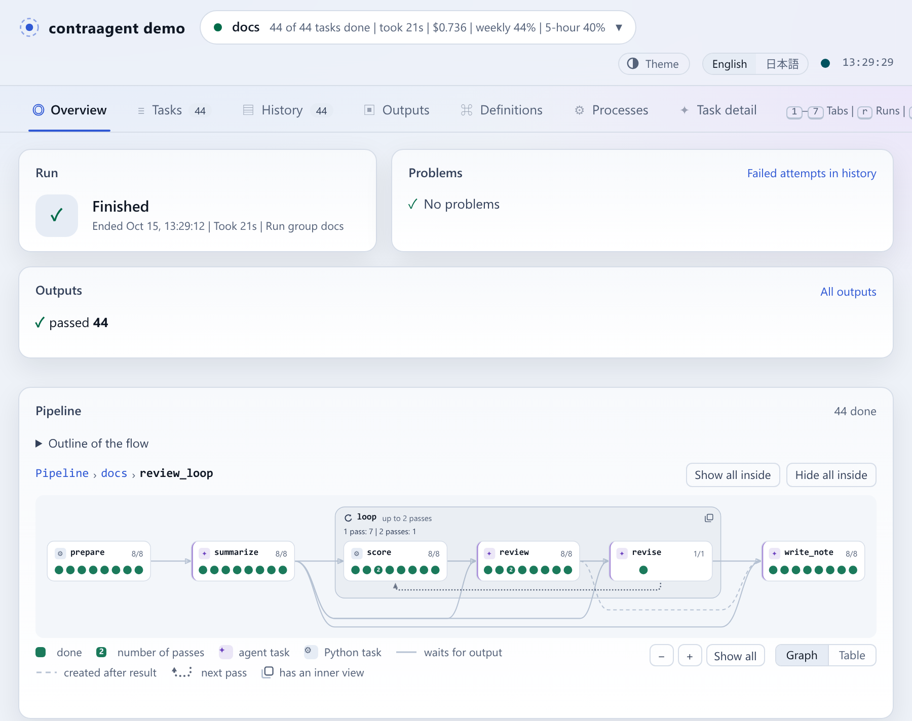
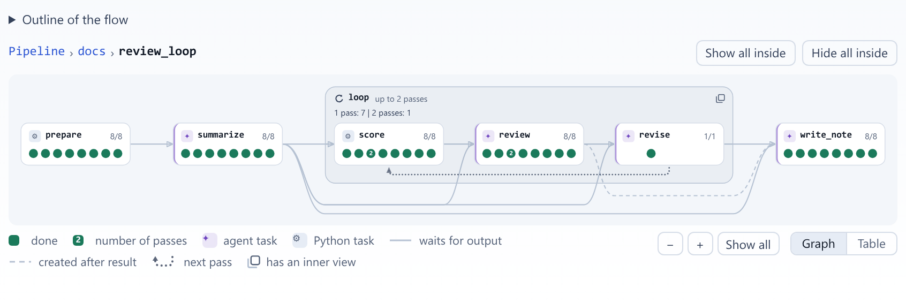
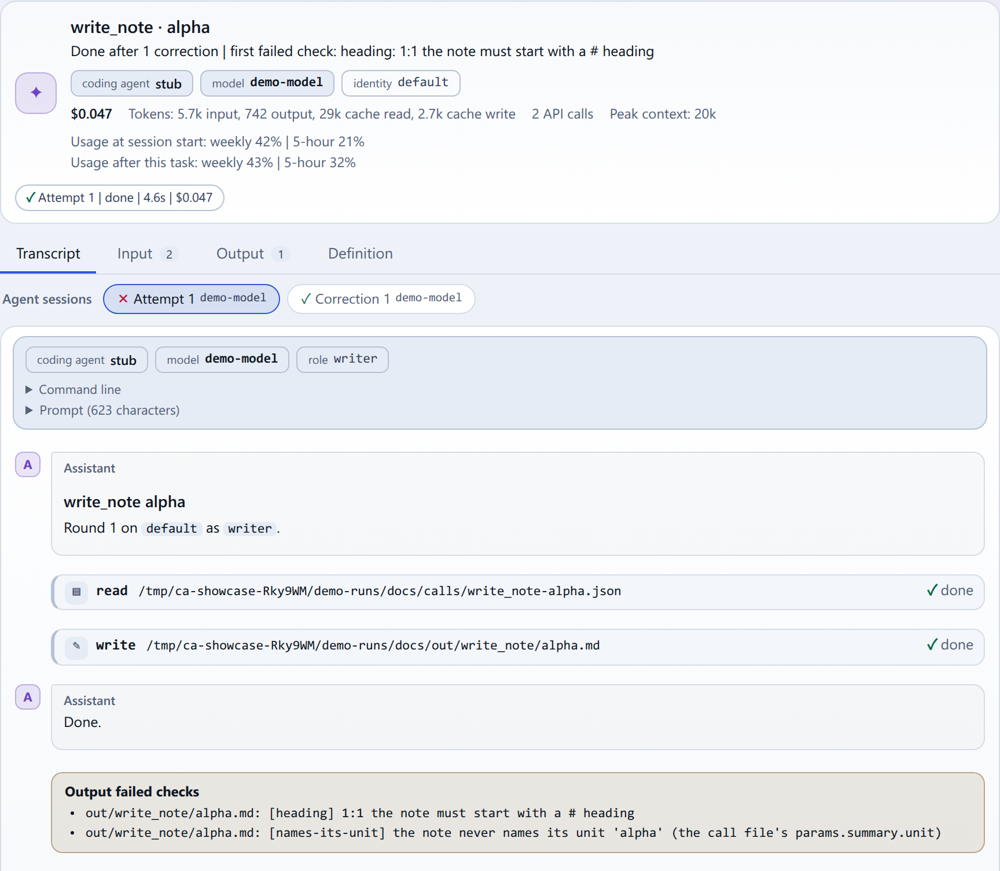
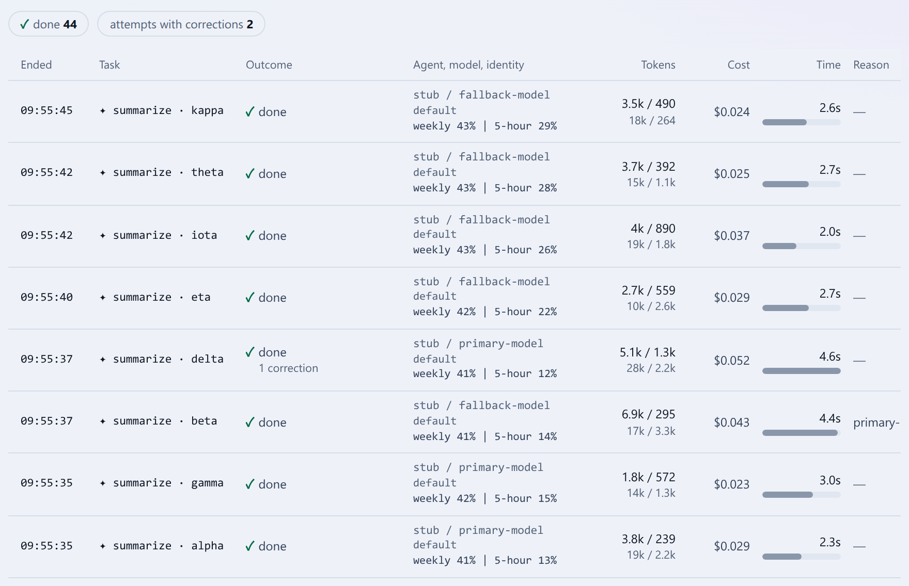
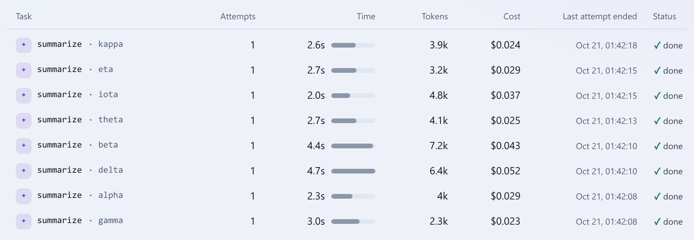
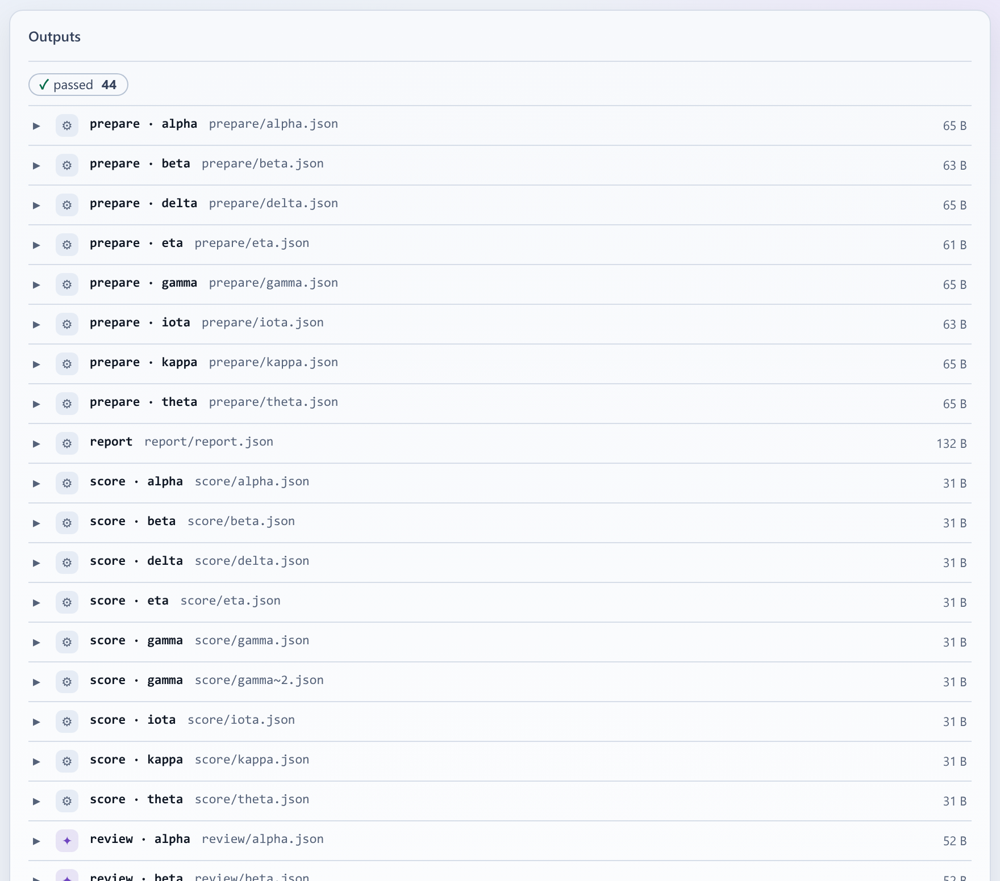
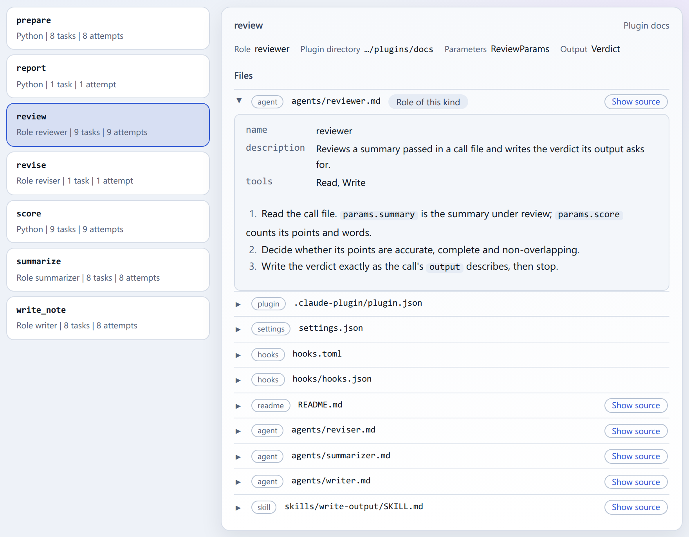
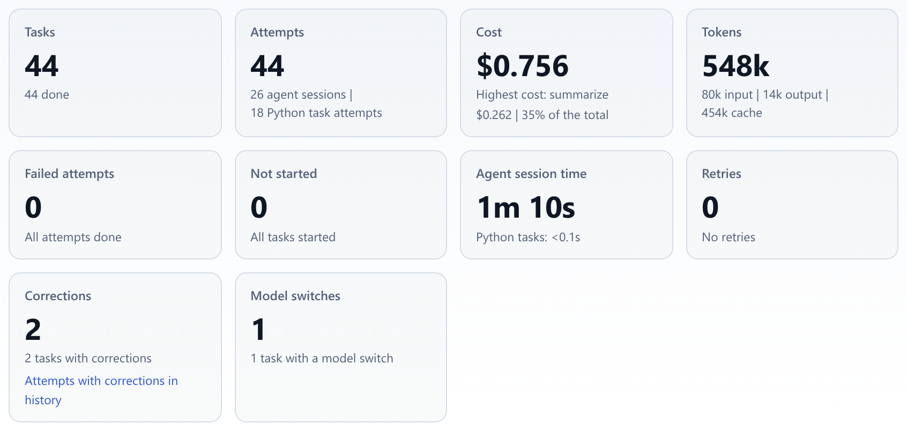
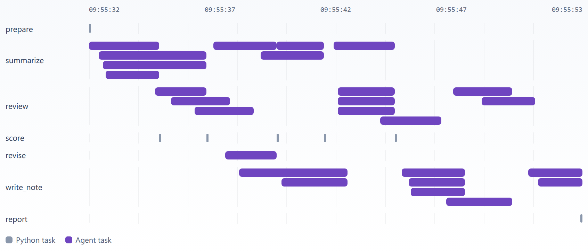

# @contraagent/ui

The contraagent monitor and each of its views as web components (Lit):
`<ca-monitor>` is the whole monitor, and every view is an element of its own,
from the transcript to the timeline. An element renders the data you set on its
properties and reports what the reader asks for as an event; it never fetches
unless it is one of the few that tail a live feed. They work in any page or
framework. The data comes from [`@contraagent/api`](../api/README.md); the
generic parts they are built from (design tokens, themes, primitives, `cae-*`
elements) are [`@contraagent/elements`](../elements/README.md), a package of
its own for pages that need no contraagent data.

The words used here (run, task, attempt, round, element, view route, ...) are
contraagent's, each with one meaning: `contraagent docs concepts` in the Python
package.

## Getting it

Every monitor serves the kit as one ES module at `/app.js`: the elements
register themselves, and the client, store and helpers are its exports. Start
the monitor with `--cors-origin` naming your page's origin.

```html
<script type="module" src="http://127.0.0.1:8787/app.js"></script>
<ca-monitor base-url="http://127.0.0.1:8787" history="memory"></ca-monitor>
```

The packages are not in the npm registry; install them from a checkout of the
repository ([Use it from a checkout](#use-it-from-a-checkout)). In a page with
a build step, import the package once: every element registers itself. Lit and
Lit Localize are peer dependencies. Importing changes nothing else in the page:
call `configureLocales()` for the languages and `adoptThemes(document)` for the
themes, or let `<ca-monitor>` call both when it connects.

```ts
import '@contraagent/ui';
import { configureLocales } from '@contraagent/ui/localize';
import { adoptThemes } from '@contraagent/elements/themes';

configureLocales();
adoptThemes(document);
```

One view alone is a subpath; it registers its `ca-*` elements and the `cae-*`
elements they render, and nothing of the other views:

```ts
import '@contraagent/ui/transcript'; // <ca-transcript>
```

The views are `monitor`, `overview`, `pipeline-graph`, `task-view`,
`transcript`, `task-table`, `journal-table`, `contracts`, `definitions`,
`kpis`, `timeline` and `procs`. `adapters`, `words`, `core` and `localize`
hold functions and register nothing. `@contraagent/ui/bundle` is one
self-contained, minified module (Lit and the translations included) for pages
without a build step.

## The views

Each view over a run of the demo pipeline, in the contraagent Light theme.

<!-- not on the site -->
On the documentation site (`pnpm docs` in `web/`), each view is live in place of
its screenshot, fed with the same run.

`<ca-monitor>`, the whole monitor (`monitor`): the run's header, its tabs, and the overview.



`<ca-pipeline-graph>` (`pipeline-graph`): the flow by function and loop, a mark per task.



`<ca-task-view>` (`task-view`): one task's agent sessions, transcript, input, output and definition.



`<ca-journal-table>` (`journal-table`): every attempt with its outcome, coding agent, model, tokens, cost and time.



`<ca-task-table>` (`task-table`): every task with its status.



`<ca-contracts>` (`contracts`): every checked file and its result.



`<ca-definitions>` (`definitions`): each kind's interface and its plugin's files.



`<ca-kpis>` (`kpis`): the run's totals.



`<ca-timeline>` (`timeline`): each attempt as a bar on a time axis, a lane per kind.



## Use it from a checkout

In the repository's `web/` (Node 22, pnpm through `corepack enable`):

```
pnpm install && pnpm tarballs
```

`pnpm tarballs` builds `@contraagent/api`, `@contraagent/elements` and
`@contraagent/ui` and writes one `.tgz` file for each to `web/tarballs/`. A
tarball names the others it depends on by their absolute path there. Then, in
your project, install the three, with npm or pnpm:

```
npm install <checkout>/web/tarballs/*.tgz
pnpm add <checkout>/web/tarballs/*.tgz
```

## Documentation

- [Embed the monitor](docs/embed.md): the whole monitor inside a page or an application of your own.
- [Live data](docs/live-data.md): elements fed by the client, the live feeds and the store.
- [Events and the view route](docs/events.md): what elements ask for, and how the monitor keeps the reader's place.
- [Theming](docs/theming.md): colours and fonts as `--ca-*` custom properties.
- [Languages](docs/languages.md): English and Japanese, and how to add a language.

Every element's properties, attributes and events are in `custom-elements.json`,
generated from the sources with the package.

A `::code` line quotes a file of the package; the documentation site (`pnpm docs` in `web/`) shows the quoted lines in place. The same declarations, with their comments, are in `dist/**/*.d.ts`.
